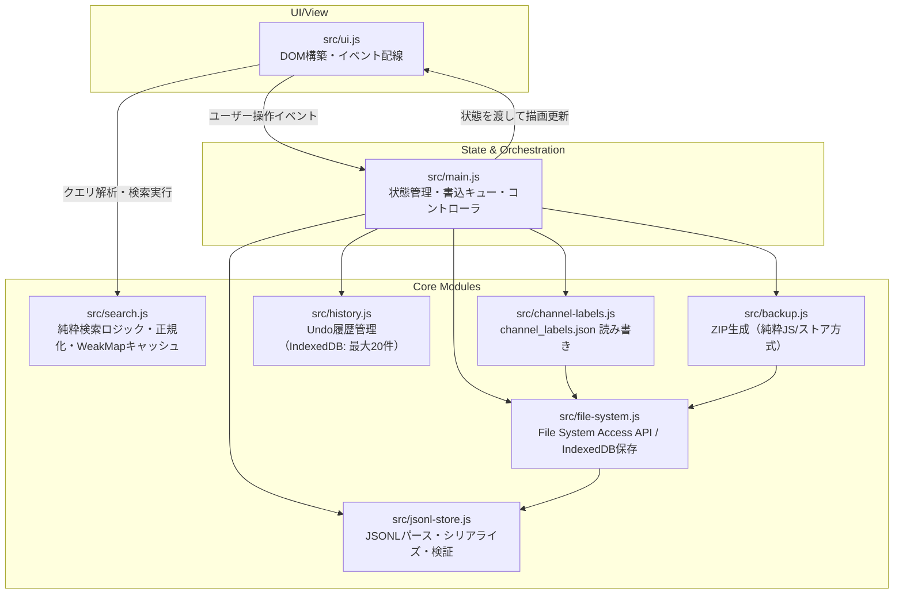
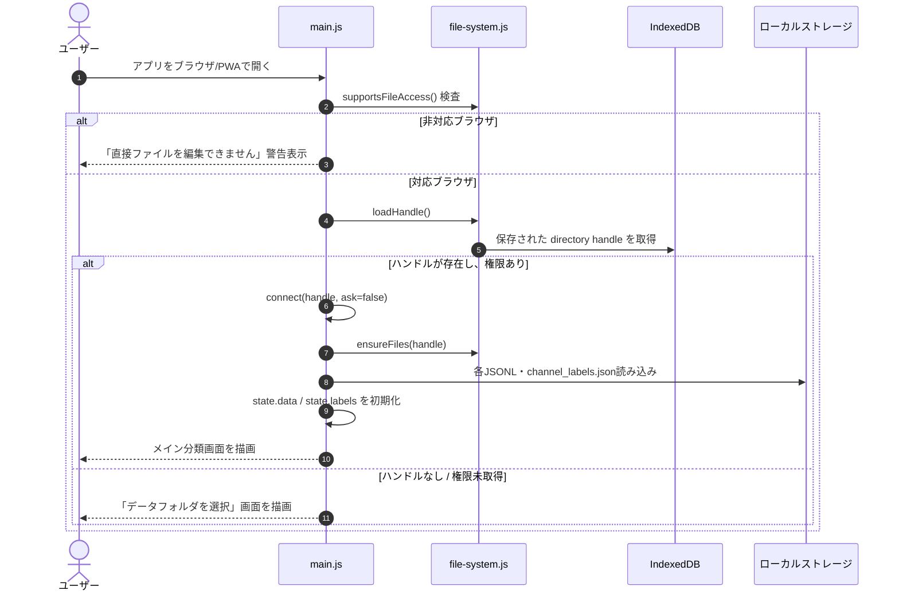
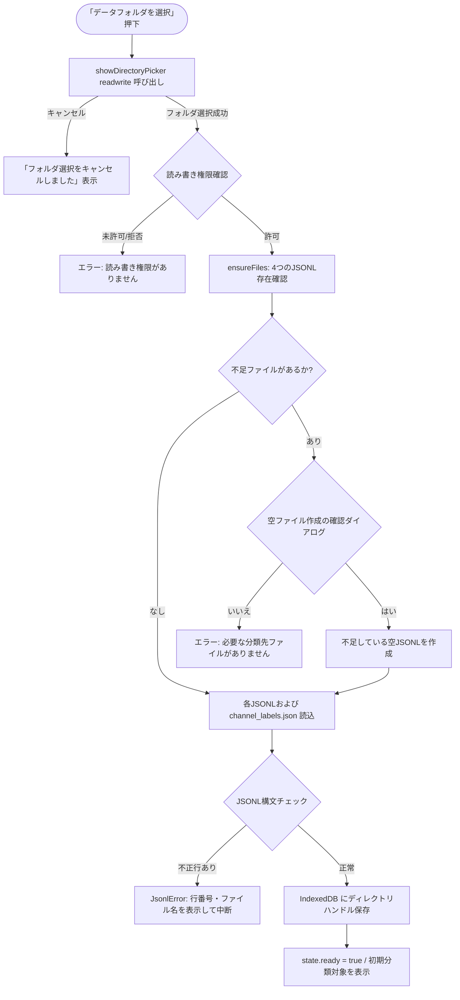
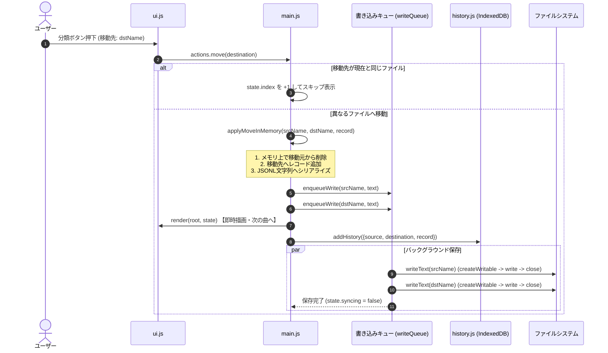
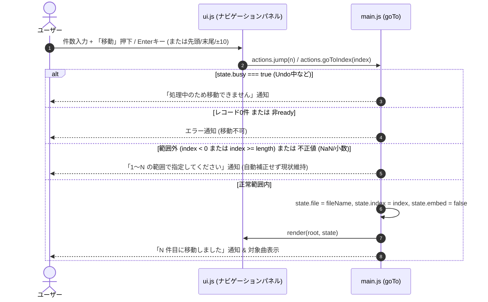
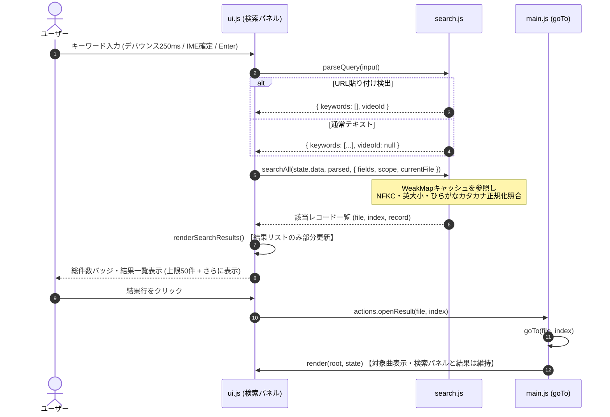
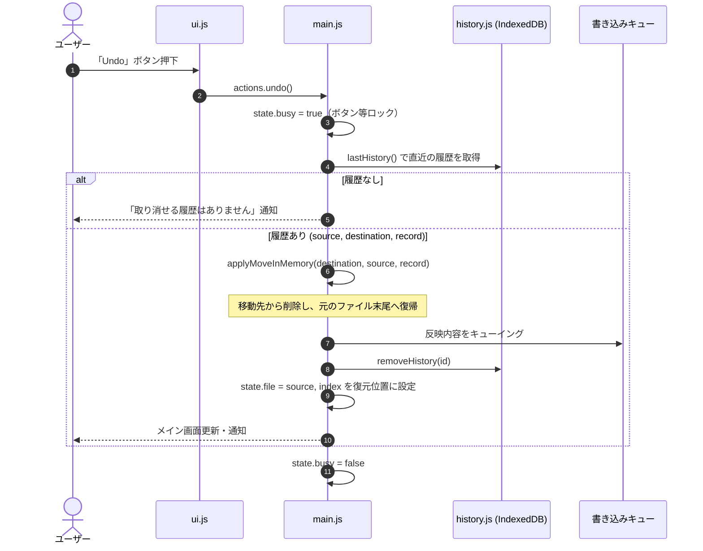
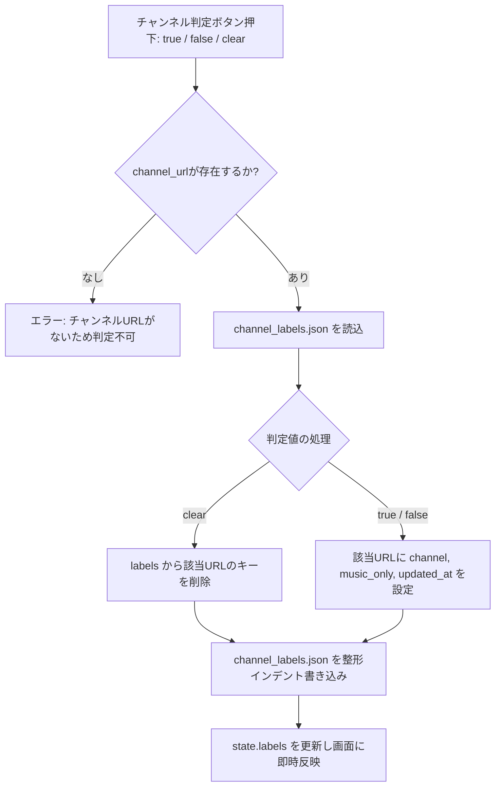
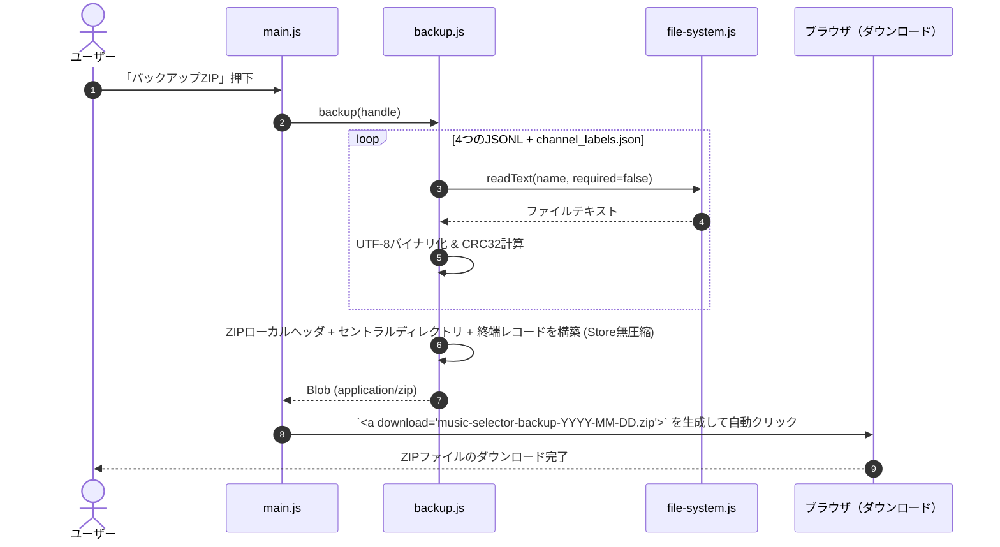

# YouTube Video Selector 全体処理フロー設計書

本ドキュメントは、**YouTube Video Selector（YouTube Music Selector）** のシステムアーキテクチャ、画面遷移、データ処理、例外処理などの全体フローをまとめた技術仕様・フローガイドです。

---

## 1. プロジェクト概要

### 1.1 目的
Android端末などのローカルストレージにある YouTube 視聴履歴（JSONL形式）を、1件ずつ確認しながら「楽曲候補」や「対象外」へ安全かつ直感的に分類するオフライン対応PWA（Progressive Web App）です。

### 1.2 コア設計思想
- **完全ローカル完結**: サーバー通信・外部CDN・アクセス解析を一切行わない。
- **データ破壊防止（Safety First）**:
  - 元データのプロパティ構造を完全に保持。
  - 不正行・破損JSONの検知と書き込み中断。
  - メモリ即時更新＋バックグラウンドキューによる快適なUIと整合性の両立。
- **PWA / オフライン動作**: Service Workerによる静的リソースのプリキャッシュにより、通信が切断された状態でも分類・Undo・バックアップが可能。
- **File System Access API & IndexedDB**:
  - ローカルフォルダへの直接読み書き。
  - フォルダハンドルおよびUndo履歴（最大20件）を IndexedDB に永続化。

---

## 2. システム構成とモジュール責務

### 2.1 モジュール別役割一覧

| モジュール | 主な役割・責務 |
| :--- | :--- |
| `src/main.js` | アプリケーションのエントリーポイント。全体状態 (`state`) の保持、書き込みキュー (`writeQueue`) の制御、イベントハンドラの実装、`goTo` による安全な位置移動制御、検索状態管理 (`setSearch`, `openResult`)。 |
| `src/ui.js` | 画面全体のHTMLレンダリング、ナビゲーションパネル（ジャンプ・検索タブUI）、検索結果の部分更新、入力中判定ヘルパー (`isTypingTarget`)、YouTube埋め込み制御、各種DOMイベント配線。 |
| `src/search.js` | 検索クエリ解析、NFKC・小文字・ひらがなカタカナ正規化、YouTube URL からの動画ID抽出、レコードマッチング、WeakMap による正規化キャッシュ（純粋関数）。 |
| `src/file-system.js` | File System Access API を用いたファイル・フォルダハンドルの操作、読み書き、IndexedDBへのハンドル永続化。 |
| `src/jsonl-store.js` | JSONLテキストとオブジェクト配列の相互変換、空行スキップ、破損行検知 (`JsonlError`)、ハッシュ指紋生成。 |
| `src/channel-labels.js` | チャンネル単位の判定情報 (`channel_labels.json`) の読み込みおよび安全な更新。 |
| `src/history.js` | 移動履歴（最大20件）を IndexedDB (`music-selector` / `history`) に保存・取得・削除。 |
| `src/backup.js` | 外部ライブラリを使わずに標準API (Uint8Array, Blob, TextEncoder) だけでZIPバイナリを構築してエクスポート。 |

---

## 3. アプリ起動と初期化フロー

アプリを開いた際の自動接続・初期フォルダ検証フローです。

---

## 4. データフォルダの選択・接続フロー

初回利用時、またはフォルダ再選択時の詳細フローです。4つの必須ファイル（`likely.jsonl`, `possible.jsonl`, `unknown.jsonl`, `excluded.jsonl`）の存在確認と不足時の自動生成を行います。

---

## 5. 楽曲分類（レコード移動）フロー

分類ボタンを押した際の処理シーケンスです。  
**メモリ即時反映（楽観的UI更新）** と **非同期書き込みキュー（FIFO集約）** により、軽快な操作感を保ちながらファイル不整合を防止します。

### 5.1 同時書き込み・離脱防止の仕組み
- **キューの集約**: 同一ファイルに対する複数回の変更は `writeQueue.set(fileName, text)` により常に最新のシリアライズ文字列に上書き集約され、不要な中間I/Oを省きます。
- **`beforeunload` ガード**: 書き込みキューが残っている状態でタブやブラウザを閉じようとした場合、警告を出してデータ消失を防ぎます。

---

## 6. ジャンプ（位置移動）フロー

現在表示中のファイル内で、指定した「N件目（1始まり）」のレコードへ直接移動する機能です。  
ファイルI/O、IndexedDB履歴、書き込みキューには**一切触れず**、メモリ上の状態変更と画面再描画のみを行います。

### 6.1 設計のポイント
- **「N件目」の定義**: 空行を無視したメモリ上のレコード配列インデックスに 1 を加えた位置（1始まり）。
- **範囲外の非補正**: 誤入力で意図しない位置へ移動する事故を防ぐため、自動クランプは行わずエラーメッセージを出して移動しません。
- **入力確定契機**: `input` イベントによる自動移動は行わず、「移動」ボタン押下または Enter キー確定時のみ実行します（YouTube iframe の多重読み込み防止）。
- **拡張性**: 内部関数 `goTo(fileName, index)` はファイル名を受け取るシグネチャとなっており、将来の複数ファイル横断検索機能からも再利用可能です。

---

## 7. 検索フロー

動画ID・タイトル・チャンネル名をキーワード検索し、結果一覧から該当レコードへ直接ジャンプする機能です。
ファイルI/O、IndexedDB履歴、書き込みキューには**一切触れず**、完全読み取り専用で動作します。

### 7.1 設計のポイント
- **派生データとしての結果導出**: レコードの分類やUndoによって配列インデックスが変動するため、検索結果はキャッシュせず、現在の `state.data` から都度導出します。
- **入力フォーカスと埋め込みの保護**: 全画面再描画（`render`）に巻き込まず、結果リスト領域（`#search-results`）のみを in-place に部分更新することで、YouTube iframe の再読み込みや入力中のフォーカス喪失を防ぎます。
- **日本語入力（IME）とデバウンス**: `compositionstart`〜`compositionend` 中は検索を抑制し、通常入力は 250ms のデバウンスで実行します。Enter キー押下時は即時実行されます。
- **XSS防止**: 外部データ（タイトル・チャンネル名）はすべて `textContent` / `document.createElement` を用いて描画し、`innerHTML` による直接展開を行いません。
- **大文字小文字の厳密性**: YouTube の動画IDは case-sensitive なため大文字小文字を区別し、タイトルやチャンネル名は大小文字・全半角・ひらがなカタカナを吸収して照合します。

---

## 8. Undo（取り消し）フロー

直前に行った分類操作を取り消し、元のファイルへレコードを戻します。

---

## 9. チャンネル判定フロー

楽曲自体の分類とは独立して、チャンネル単位で「楽曲専用」「楽曲専用ではない」を `channel_labels.json` に記録します。

---

## 10. バックアップ（ZIP生成）フロー

ローカルにある全4つのJSONLファイルと `channel_labels.json` をメモリ上で単一のZIPバイナリにパッケージ化し、ブラウザのダウンロード機能で保存します。

---

## 10. エラーハンドリングと安全性ポリシー

| 発生事象 | 検知箇所 | システムの振る舞い / ユーザーへの提示 |
| :--- | :--- | :--- |
| **ブラウザ非対応** | 起動時 (`supportsFileAccess`) | 「このブラウザでは直接ファイルを編集できません」と通知。 |
| **フォルダ権限失効** | 再接続時 (`permission`) | IndexedDBにハンドルがあっても再許可ダイアログを促す。 |
| **ファイル欠損** | フォルダ接続時 (`ensureFiles`) | 不足ファイル名を明示し、ユーザー承認後にのみ空ファイルを新規作成（既存ファイルは保護）。 |
| **JSONLパースエラー** | 読込時 (`jsonl-store.js`) | 不正な行番号とファイル名を明示し、安全のため書き込み・処理を中断。 |
| **書き込み失敗** | 保存キュー実行時 (`drainWrites`) | キューを停止し、「ファイルの保存に失敗しました。バックアップを取得してください」と警告。 |
| **ページ離脱** | `beforeunload` イベント | 書き込みキュー残存時にブラウザ警告を発動し、データ消失を防ぐ。 |
| **同一ファイル移動** | 分類操作時 (`move`) | ファイル書き込みを行わず、次レコードへのスキップ処理として扱う。 |
| **ジャンプ範囲外** | ジャンプ操作時 (`goTo`) | 自動クランプせず「1〜N の範囲で指定してください」と表示し、移動を拒否。 |
